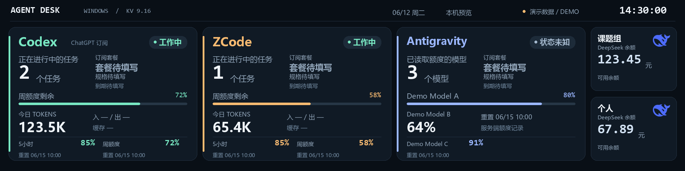

# KV Agent Desk

KV Agent Desk 是面向 Windows 的本地 AI Agent 仪表盘，可将 Thermalright（利民）KV / Trofeo Vision 9.16 的 USB LCD 用作 Codex、ZCode、Antigravity 与 DeepSeek 账户的状态屏。界面设计参考了 [MacTR AI](https://github.com/m1ng-li/mac-thermalright-ai-monitor) 的 LCD Agent 面板方向；本项目使用独立的 Windows 实现，没有复制该项目的代码或图片。



> 上图是合成演示：名称、模型、数值和日期均为虚构，不代表任何真实账户或使用记录。

## 功能

- **KV 9.16 LCD 输出**：通过 Windows 自带 WinUSB 接口写入设备，不安装第三方 USB DLL，也不更换设备驱动。逻辑画布为 1920 × 480；当前公开协议资料将 9.16 屏的传输图像识别为 1920 × 462，因此默认按 1920 × 462 发送。若你的屏幕固件使用 480 高度，可在启动参数中试用 `--lcd-height 480`。
- **Codex / ChatGPT**：读取本机 Codex 会话记录，显示可靠时的工作状态、进行中任务数、当日 Token 和额度窗口。5 小时与周额度依据本机实际记录；无法读取时显示未知。若账户确实没有 5 小时窗口，可在控制页勾选“ChatGPT 无5小时限额”，此个人设置会将该窗口显示为 100%。
- **ZCode**：只读本地会话数据库，显示可靠时的工作状态、进行中任务数、当日 Token；对于当前选中的官方 Coding Plan，尝试读取额度、套餐信息和重置时间。
- **Antigravity**：从已运行的本机 language server 查询模型额度和重置时间。这个适配器不推断固定的 5 小时或周周期，也不读取 Token 或任务数。
- **两个 DeepSeek 余额卡片**：分别为“课题组”和“个人”预留独立槽位；只调用 DeepSeek 官方余额 GET 接口，不发起模型推理请求。需要在 Windows 环境变量中配置 `DeepSeek_public` 和/或 `DeepSeek_personal`。
- **手动套餐资料**：Codex、ZCode、Antigravity 均可手动补充套餐名称、规格和到期日期；手动填写优先显示，清空后恢复自动信息。
- **保留最后可信数据**：来源暂不可读或数据过期时继续展示最后值，并用低调提示标记“数据待检查更新”；开机时先恢复上次屏幕画面，再更新来源数据。

LCD 不显示任务名称或计划步骤，只显示进行中的任务数和周额度百分比。未知额度保持未知，不将其伪装为 0% 或 100%。

## 运行要求

- 硬件：Thermalright KV / Trofeo Vision 9.16 LCD，通过支持数据传输的 USB 接口连接；已验证的设备标识为 `VID:PID 0416:5408`。其他共用 USB 标识的型号尚未验证，不能只凭 VID/PID 判断兼容。
- Windows 10 或 Windows 11，64 位。
- 本机 KV 9.16 USB 接口需由 Windows 设备管理器以 WinUSB 驱动提供。应用只使用系统提供的 WinUSB API，不会安装或替换驱动。
- 原生窗口需要 Microsoft Edge WebView2 Evergreen Runtime。若未安装，先从 [Microsoft WebView2 下载页](https://developer.microsoft.com/microsoft-edge/webview2/)安装 Evergreen Runtime。
- 从源码构建需要 Python 3.12 x64 和 PowerShell。
- 向 LCD 输出时，KV Agent Desk 会独占对应 USB 接口。请先暂停本应用的 USB 输出或退出应用，再使用 Thermalright TRCC；两者不能同时驱动同一屏幕。TRCC 可以继续安装，互斥来自 USB 接口的独占打开方式。

## 安装与启动

### Windows 发布版

从 [GitHub Releases](https://github.com/WangSonglin992/kv-agent-desk/releases) 下载 `KV-Agent-Desk-windows-x64.zip`，解压后运行 `KV-Agent-Desk.exe`，无需安装 Python。便携包附带公开说明与依赖许可，下载页同时提供 SHA-256 校验文件；校验方式见 [发布说明](docs/RELEASING.md)。首次启动的默认行为是启用 USB 输出并登记当前 Windows 用户的开机自启；可在控制页取消“开机自启并恢复上次画面”。

### 从源码构建

在仓库根目录打开 PowerShell，运行：

```powershell
powershell -ExecutionPolicy Bypass -File .\Build-Dashboard.ps1
.\Start-Dashboard.cmd
```

构建脚本使用 Python 3.12 创建 `.venv`、安装锁定的构建依赖、运行单元测试，再生成 `dist\KV-Agent-Desk.exe`。之后可直接运行该 EXE，或用启动脚本启动。

如要在 Python 环境中直接运行源码，可先按 `requirements.txt` 安装运行依赖，再执行：

```powershell
python .\run_dashboard.py
```

首次启动后，桌面窗口可关闭到系统托盘，应用继续运行；从托盘菜单可打开控制页、暂停/恢复 USB 输出或退出。退出应用请使用托盘菜单的“退出”或控制页的“退出应用”。控制页默认位于本机 `http://localhost:8765/`；`Start-Dashboard.cmd --browser-only` 可改用外部浏览器预览。开机自启面向已构建的 EXE，纯源码运行时应先构建再启用。

### 演示与预览

```powershell
dist\KV-Agent-Desk.exe --demo
dist\KV-Agent-Desk.exe --preview-only
```

`--demo` 使用合成数据并禁用 USB 输出；`--preview-only` 仅禁止 USB 屏幕写入，仍可查看本机控制页。需要对照屏幕尺寸时可使用 `--lcd-height 480`；方向可在控制页设置为 0° 或 180°，默认旋转 180°。亮度是画面软件调光，不会修改面板硬件背光。

## 数据来源与边界

各 Agent 使用本机已安装并登录的客户端数据，不在本应用中登录。DeepSeek 可在 Windows 的“编辑账户的环境变量”中新增 `DeepSeek_public`（课题组）和 `DeepSeek_personal`（个人），值分别填写对应账户的 Key；只配置一个也可使用。修改后需彻底退出托盘应用并重新启动。仓库不提供预填账户配置，也不要求把 Key 写入源文件。

| 面板 | 数据来源 | 能显示什么 | 目前的边界 |
| --- | --- | --- | --- |
| Codex | 本机 Codex session JSONL | 状态、进行中任务数、当日 Token、已观察到的额度窗口 | Codex 本地记录格式可能变化；没有观测到的字段会显示未知。 |
| ZCode | 本机 ZCode SQLite 会话库；已选官方 Coding Plan 的额度 API | 状态、进行中任务数、当日 Token、套餐/额度和重置时间 | 额度刷新依赖当前选中的套餐配置和官方接口可用性。数据库以只读方式打开，不读取消息正文或工具参数。 |
| Antigravity | 已运行的官方客户端 language server 的本机接口 | 已报告的模型额度及其重置时间 | 不推断额度周期；当前适配器不提供 Token、任务计数或套餐到期信息。套餐资料可手动填写。 |
| DeepSeek | 环境变量中的账户 API Key → DeepSeek 官方余额接口 | 账户余额与币种 | 不代表订阅或周额度；两个账户槽位各自独立，缺少 Key 时不发请求。 |

数据更新目标间隔约 2 秒，来源自身的读取耗时会影响实际间隔；账户余额和供应商额度接口至少间隔 60 秒请求一次。详情见 [隐私与本地数据说明](docs/PRIVACY.md)。

## 设置与本地数据

控制页可调整方向、屏幕画面亮度、USB 输出、自启、ChatGPT 5 小时窗口显示策略和套餐资料。默认自动启动仅登记到当前 Windows 用户的 `Run` 项；应用不会创建系统服务或管理员级开机任务。桌面关闭按钮只会隐藏窗口到托盘，托盘“退出”才会停止应用并释放屏幕接口。

运行缓存和设置保存在 `%LOCALAPPDATA%\KV-Agent-Desk`。请阅读 [隐私说明](docs/PRIVACY.md)，尤其是最近会话统计、账户余额、手动套餐信息和屏幕快照的本机保留方式。

## 扩展 Agent 面板

项目按采集适配器、状态保留、渲染和 UI 分层。若要增加一个 Agent，请先阅读 [扩展指南](docs/EXTENDING.md)，其中包含需要新增的适配器契约、注册位置、额度字段处理、渲染和测试步骤。新来源应只采集可核实数据；未知状态应保留为未知，并遵守本地只读与密钥保护原则。

## 许可

本项目代码按 MIT License 发布。运行依赖、构建依赖、DeepSeek 标志图片和参考过的设备协议资料各自保留原许可或权利归属，见 [第三方声明](THIRD_PARTY_NOTICES.md)。
